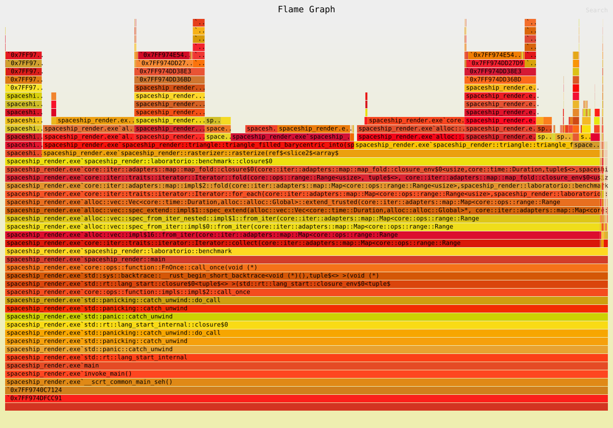

# Spaceship Render

[English](README.md) · **Español**

Renderer por software escrito en Rust para el curso de Gráficas por Computadora (UVG).
Carga un modelo `.obj` hecho en Blender y dibuja sus triángulos, en contorno o
rellenos, con algoritmos propios. Raylib solo se usa para abrir la ventana, mostrar el
framebuffer como textura y guardar la captura en PNG; **no** se usan sus funciones
para cargar ni dibujar modelos.

## Proyecto 1 — Parte 1: dibujando un modelo OBJ


| | |
|---|---|
|  |  |

Modelo: `spaceship.obj`, 286,689 vértices y 573,439 triángulos.

Como todavía no hay proyección, se dibujan directamente las componentes `x` y `y`
de cada vértice (vista de frente). Los vértices se escalan con la misma escala en
ambos ejes y se trasladan para que el modelo quede centrado y ocupe el 90 % de la
ventana sin salirse.

## Cómo ejecutarlo

Requisitos: Rust (toolchain MSVC en Windows) y CMake, que el crate `raylib` usa para compilar Raylib.

Para abrir el visor de la nave:

```sh
cargo run --release -- --nave
```

Abre una ventana de 1024×768 con el modelo. Usa `--release`: en modo debug dibujar
573k triángulos es mucho más lento.

### Controles

| Entrada | Acción |
|---|---|
| Arrastrar con clic izquierdo / flechas | Rotar el modelo |
| Rueda del mouse | Zoom |
| `R` | Regresar a la vista inicial |
| `1` / `2` / `3` | Modo: wireframe / relleno baricéntrico / relleno scanline |

La ventana arranca con el zoom necesario para que el modelo quepa completo desde
cualquier ángulo. Solo se vuelve a dibujar cuando la cámara se mueve.

Para guardar la vista de frente en `captura.png` sin abrir la ventana:

```sh
cargo run --release -- --nave --captura
```

Sin `--nave` (`cargo run --release`) se abre la escena de prueba del laboratorio de
relleno; las teclas `1`, `2` y `3` cambian el modo. Otros modos del programa:

```sh
cargo run --release -- --capturas-relleno    # guarda docs/relleno_*.png
cargo run --release -- --benchmark-triangles # mide la rasterización de cada modo
```

Para correr los tests:

```sh
cargo test
```

> **Windows:** `.cargo/config.toml` le indica a `bindgen` dónde están los headers de
> MSVC porque en la máquina de desarrollo no los encontraba solo. Si tu instalación de
> Visual Studio está en otra ruta, ajústala ahí (o borra el archivo si compila sin él).

## Cómo funciona

```
spaceship.obj → Obj → arreglo de vértices → matriz de modelo (Uniforms) → triángulos → fragmentos → framebuffer → ventana
```

| Archivo | Qué hace |
|---|---|
| `src/obj.rs` | Cargador de OBJ: lee las líneas `v` (posiciones) y `f` (caras), convierte los índices de base 1 a base 0 y acepta grupos como `5/7/2`. `get_vertex_array()` devuelve los vértices ordenados por caras. |
| `src/vertex.rs` | `Vertex` con su `position` original, `color` y `transformed_position` en coordenadas de pantalla. |
| `src/render.rs` | Matriz de modelo (`create_model_matrix`), cámara orbital, encuadre y la transformación que llena `transformed_position`. |
| `src/triangle.rs` | `triangle` (contorno), `triangle_filled_barycentric` y `triangle_filled_scanline` devuelven los fragmentos de un triángulo. |
| `src/rasterizer.rs` | `TriangleMode` y `rasterize`, que genera los fragmentos de todos los triángulos en el modo elegido. |
| `src/primitive.rs` | Ensamblaje de primitivas: agrupa los vértices de tres en tres. |
| `src/shaders.rs` | `vertex_shader` (aplica la matriz de modelo) y `fragment_shader` (passthrough). |
| `src/laboratorio.rs` | Escena de prueba, capturas y mediciones del laboratorio de relleno. |
| `src/line.rs` | `line` (algoritmo de Bresenham) devuelve los fragmentos de una línea. |
| `src/fragment.rs` | `Fragment`: candidato a píxel con posición, color y profundidad. |
| `src/framebuffer.rs` | Buffer de color y z-buffer propios; `init_texture` / `swap_buffers` lo muestran en la ventana. |
| `src/color.rs` | Color RGB de 8 bits por canal. |
| `src/main.rs` | `Uniforms`, la función `render` (pipeline de 4 etapas) y la escena de prueba. |
| `src/visor.rs` | Visor de la nave: carga el modelo y maneja la cámara y la entrada. |
| `src/vertices.rs` | Ejercicio de la fase de vértices (`Vector2` y `Vector3`). |

## Laboratorio: rellenar triángulos

`rasterize` recibe un `TriangleMode`:

```rust
pub enum TriangleMode { Wireframe, FilledBarycentric, FilledScanline }
```

El ensamblaje de primitivas y el procesamiento de fragmentos no cambian; solo cambia
cómo cada triángulo se convierte en fragmentos.

### Imágenes de cada modo

Escena de prueba: triángulo pequeño (amarillo), grande (azul), con borde horizontal
(verde), con borde vertical (rosa), el mismo con sus vértices en orden inverso (morado,
180 px más abajo), parcialmente fuera del framebuffer (naranja) y tres vértices sobre una
misma línea (rojo).

| Wireframe | FilledBarycentric | FilledScanline |
|---|---|---|
|  |  |  |

El triángulo rojo (vértices colineales) solo aparece en wireframe: su área es cero, así
que los rellenos lo tratan como degenerado, no generan fragmentos y no dividen entre
cero. El morado tiene exactamente las mismas posiciones que el rosa.

### Los dos algoritmos

- **Baricéntrico:** recorre el rectángulo que envuelve al triángulo y, para el centro de
  cada píxel `(x + 0.5, y + 0.5)`, calcula sus tres coordenadas baricéntricas (con
  *edge functions*). Si las tres indican que el centro está adentro, genera un fragmento.
- **Scanline:** para cada fila calcula dónde la cruzan las aristas y genera los fragmentos
  entre esos dos extremos, sin evaluar los píxeles del interior.

**Una sola regla para los bordes.** Los dos usan la misma prueba para decidir si un centro
está dentro, con la regla *top-left* para los centros que caen justo sobre una arista: se
dibujan solo si la arista es superior o izquierda. Así, dos triángulos que comparten una
arista no dejan huecos ni generan el mismo píxel dos veces; un test con un cuadrado
dividido por su diagonal da exactamente 100 píxeles sin repetir.

El scanline calcula los extremos de cada fila con una división, que puede tener errores
de redondeo, y después ajusta solo esos extremos con la misma prueba del baricéntrico.
Por eso los dos algoritmos generan **exactamente las mismas posiciones**. Los tests lo
comprueban con cada caso de la escena y con 500 triángulos aleatorios, y la medición lo
comprueba con la nave completa. Las imágenes de los dos rellenos son idénticas píxel por
píxel.

Si los vértices vienen en el orden contrario, se intercambian dos para que el área sea
positiva; el triángulo no desaparece.

### Mediciones

`cargo run --release -- --benchmark-triangles`. Solo se mide `rasterize` (generar y
guardar los fragmentos): los triángulos se preparan antes y no se dibuja ninguna ventana.
Cada medición ejecuta `rasterize` varias veces con `black_box`; se reporta la mediana de 7
mediciones. La salida completa está en [`docs/benchmark.txt`](docs/benchmark.txt).

| Caso | Modo | Tiempo por ejecución | Fragmentos | ns por fragmento |
|---|---|---:|---:|---:|
| Escena de prueba (7 triángulos) | Wireframe | 0.010 ms | 3,735 | 2.72 |
| Escena de prueba (7 triángulos) | FilledBarycentric | 1.98 ms | 149,465 | 13.23 |
| Escena de prueba (7 triángulos) | FilledScanline | 1.37 ms | 149,465 | 9.16 |
| Triángulos grandes (500) | Wireframe | 1.39 ms | 124,242 | 11.22 |
| Triángulos grandes (500) | FilledBarycentric | 28.98 ms | 1,348,422 | 21.49 |
| Triángulos grandes (500) | FilledScanline | 18.66 ms | 1,348,422 | 13.84 |
| Nave (573,439 triángulos) | Wireframe | 115.05 ms | 4,441,533 | 25.90 |
| Nave (573,439 triángulos) | FilledBarycentric | 36.63 ms | 495,722 | 73.90 |
| Nave (573,439 triángulos) | FilledScanline | 56.99 ms | 495,722 | 114.97 |

Los dos rellenos generan la misma cantidad de fragmentos en cada caso, así que la
comparación es justa: ninguno es más rápido por omitir parte del triángulo.

### Diferencias que encontramos

1. **Con triángulos grandes gana el scanline (~1.5× más rápido).** El baricéntrico evalúa
   tres *edge functions* en cada píxel del rectángulo que envuelve al triángulo, y cerca
   de la mitad de ese rectángulo queda fuera del triángulo: trabajo desperdiciado. El
   scanline solo calcula los dos extremos de cada fila y luego agrega fragmentos sin
   evaluar nada.
2. **Con la nave gana el baricéntrico (~1.6× más rápido).** Sus triángulos son diminutos:
   en promedio generan **menos de un fragmento** (495,722 fragmentos para 573,439
   triángulos). Ahí pesa el trabajo fijo por triángulo, no el trabajo por píxel. El
   rectángulo del baricéntrico casi siempre tiene 0 o 1 píxeles, mientras que el scanline
   calcula cruces con las tres aristas y ajusta los extremos de cada fila.
3. **Para la nave, rellenar es ~3× más rápido que el wireframe.** Cada línea genera al
   menos un fragmento por extremo, así que un triángulo diminuto produce varios
   fragmentos en contorno (4.4M en total) y casi ninguno relleno.
4. **Guardar los fragmentos cuesta tanto como calcularlos.** Para investigarlo, repetimos
   la medición de los triángulos grandes reutilizando el mismo `Vec` en lugar de crear uno
   nuevo en cada ejecución: el scanline bajó de ~20 ms a ~5 ms y el baricéntrico de
   ~31 ms a ~15 ms. Con triángulos grandes, ~75 % del tiempo del scanline se va en pedir
   memoria nueva al sistema y llenarla (un `Vec` de ~32 MB por ejecución), no en el
   algoritmo. Sin ese costo, el scanline es ~3× más rápido que el baricéntrico.

### Perfil

```sh
cargo install flamegraph
cargo flamegraph -- --benchmark-triangles   # en una terminal de administrador
```

En Windows, `cargo flamegraph` necesita permisos de administrador para leer los eventos
de rendimiento del sistema. `Cargo.toml` activa `debug = true` en el perfil release para
que el perfil muestre los nombres de las funciones; no cambia la optimización.

[](docs/flamegraph.svg)

Abre [`docs/flamegraph.svg`](docs/flamegraph.svg) en el navegador para hacer zoom y
buscar funciones. El ancho de cada bloque es la proporción de muestras en las que apareció
esa función, no el orden en que se ejecutó.

`rasterize` aparece en el 93 % de las muestras; el resto es preparar los triángulos de la
nave y comparar las posiciones. Dentro de cada relleno, el tiempo se reparte así:

| Dentro de… | Prueba "¿está adentro?" (`dentro`, `edge`, `pasa`) | Escribir el fragmento (`Vec::push`) | Hacer crecer el `Vec` (`reserve` → `grow_amortized` → sistema) | Cruces de aristas (`tramo`) |
|---|---:|---:|---:|---:|
| `triangle_filled_barycentric_into` (52 % del total) | 38 % | 29 % | 23 % | — |
| `triangle_filled_scanline_into` (37 % del total) | 2 % | 49 % | 33 % | 8 % |

- **Baricéntrico:** el cálculo geométrico es su parte más grande (38 %): las tres *edge
  functions* que evalúa en cada píxel del rectángulo, incluidos los que quedan fuera.
- **Scanline:** casi no hace cálculos geométricos (10 % entre `tramo` y `dentro`); el
  **82 % de su tiempo es memoria**: escribir los fragmentos y hacer crecer el `Vec`.
- Los bloques sin nombre (`0x7FF9…`) son funciones de Windows (`ntdll`) que aparecen al
  copiar el `Vec` a un bloque más grande y al liberarlo.

Esto confirma el experimento de la sección anterior: en este renderer, crear y guardar
fragmentos cuesta más que decidir qué píxeles cubre el triángulo. La mejora más grande ya
no estaría en el algoritmo de relleno, sino en no guardar todos los fragmentos en un `Vec`
(por ejemplo, reutilizar el mismo `Vec` entre cuadros o escribir cada fragmento en cuanto se
genera).
