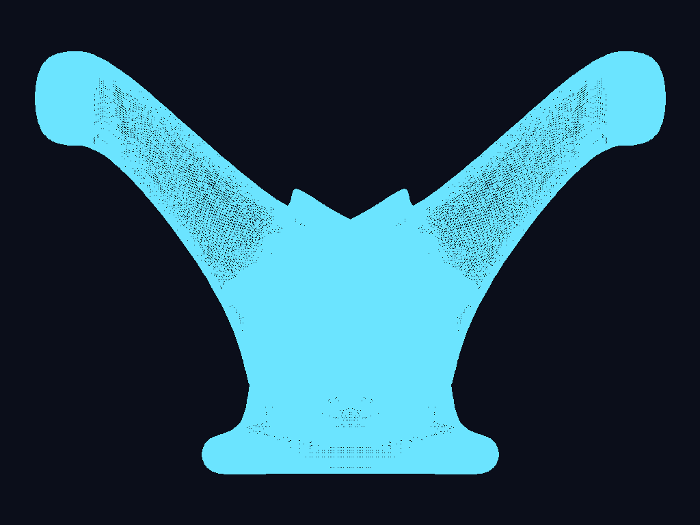

# Spaceship Render

Renderer por software escrito en Rust para el curso de Gráficas por Computadora (UVG).
Carga un modelo `.obj` hecho en Blender y dibuja el contorno de todos sus triángulos
con algoritmos propios. Raylib solo se usa para abrir la ventana, mostrar el
framebuffer como textura y guardar la captura en PNG; **no** se usan sus funciones
para cargar ni dibujar modelos.

## Proyecto 1 — Parte 1: dibujando un modelo OBJ



Modelo: `spaceship.obj`, 286,689 vértices y 573,439 triángulos.

Como todavía no hay proyección, se dibujan directamente las componentes `x` y `y`
de cada vértice (vista de frente). Los vértices se escalan con la misma escala en
ambos ejes y se trasladan para que el modelo quede centrado y ocupe el 90 % de la
ventana sin salirse.

## Cómo ejecutarlo

Requisitos: Rust (toolchain MSVC en Windows) y CMake, que el crate `raylib` usa para compilar Raylib.

```sh
cargo run --release
```

Abre una ventana de 1024×768 con el modelo y guarda la captura (vista de frente) en
`screenshot.png`.

### Controles

| Entrada | Acción |
|---|---|
| Arrastrar con clic izquierdo / flechas | Rotar el modelo |
| Rueda del mouse | Zoom |
| `R` | Regresar a la vista inicial |

La ventana arranca con el zoom necesario para que el modelo quepa completo desde
cualquier ángulo. Solo se vuelve a dibujar cuando la cámara se mueve.
Para generar solo la captura, sin abrir la ventana:

```sh
cargo run --release -- --no-window
```

Para correr los tests:

```sh
cargo test
```

> **Windows:** `.cargo/config.toml` le indica a `bindgen` dónde están los headers de
> MSVC porque en la máquina de desarrollo no los encontraba solo. Si tu instalación de
> Visual Studio está en otra ruta, ajústala ahí (o borra el archivo si compila sin él).

## Cómo funciona

```
spaceship.obj → vértices + índices → triángulos → líneas → píxeles → ventana
```

| Archivo | Qué hace |
|---|---|
| `src/obj.rs` | Cargador de OBJ: lee las líneas `v` (posiciones) y `f` (caras), convierte los índices de base 1 a base 0 y acepta grupos como `5/7/2`. |
| `src/render.rs` | Escala, centra y rota los vértices (cámara orbital, proyección ortográfica) y recorre los triángulos de tres en tres índices. |
| `src/line.rs` | `line` (algoritmo de Bresenham) y `triangle` (tres llamadas a `line`). |
| `src/framebuffer.rs` | Buffer de color y z-buffer propios; se convierte a una `Image` de Raylib para mostrarse o exportarse. |
| `src/color.rs` | Color RGB de 8 bits por canal. |
| `src/main.rs` | Carga el modelo, lo dibuja en el framebuffer, guarda la captura y abre la ventana. |
| `src/vertices.rs` | Ejercicio de la fase de vértices (`Vector2` y `Vector3`). |
