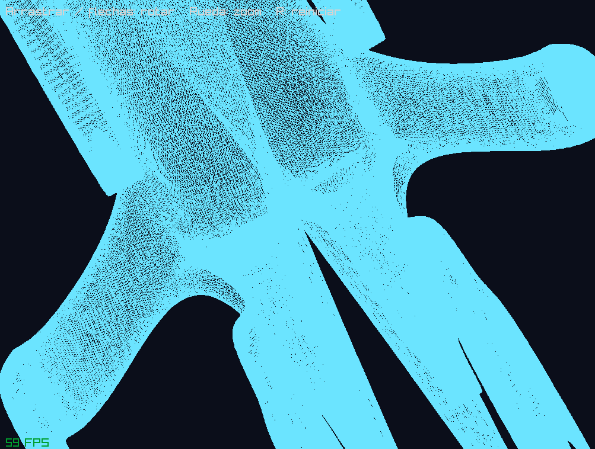
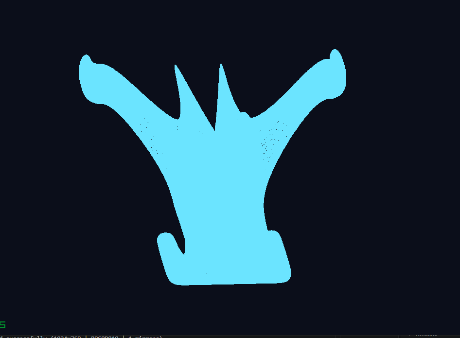
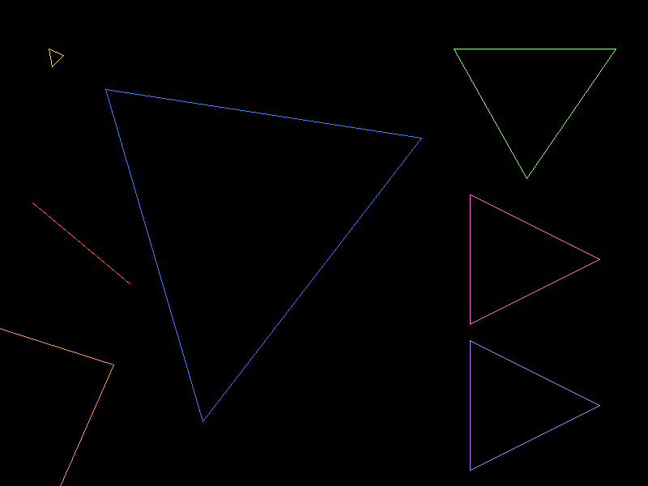
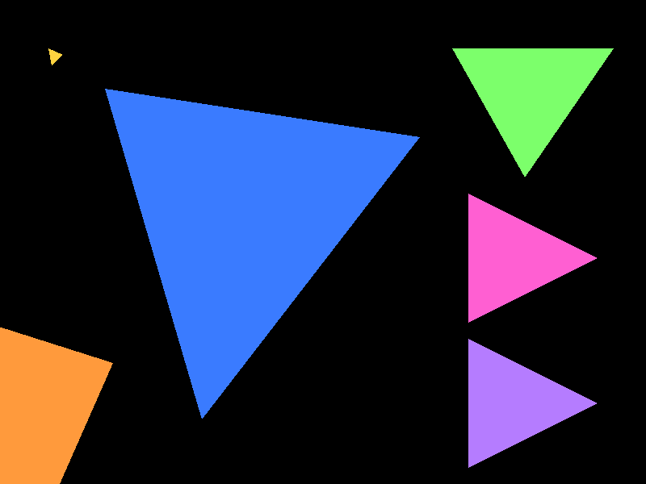

# Spaceship Render

**English** · [Español](README.es.md)

A software renderer written in Rust for the Computer Graphics course at Universidad del Valle de Guatemala (UVG).
It loads a spaceship modeled in Blender from an `.obj` file and draws its triangles, as outlines
or filled, using hand-written algorithms: an OBJ parser, a four-stage pipeline (vertex shader,
primitive assembly, rasterization, fragment shader), Bresenham lines, barycentric and scanline
triangle fills, and a custom framebuffer.

Raylib is only used to open the window, display the framebuffer as a texture and read mouse and
keyboard input. Raylib's model loading and drawing functions are **not** used. Every pixel of
the model is drawn by this project's own code.

## Screenshots


| | |
|---|---|
|  |  |

The model is `spaceship.obj`, with 286,689 vertices and 573,439 triangles.

## Features

- **OBJ loader:** reads vertex positions (`v`) and faces (`f`), converts the 1-based OBJ
  indices to 0-based, accepts the `v/vt/vn` face format and splits faces with more than
  three vertices into triangles (fan triangulation).
- **Three rasterization modes:** wireframe (three Bresenham lines per triangle), barycentric
  fill and scanline fill. Both fills produce exactly the same pixels.
- **Automatic framing:** the model is centered and scaled to fit the window.
- **Orbit camera:** you can rotate and zoom the model in real time. The projection is
  orthographic for now; perspective comes in a later stage of the course.
- **Redraw on demand:** the model is only redrawn when the camera moves.

## Running

Requirements: Rust (MSVC toolchain on Windows) and CMake, which the `raylib` crate uses to build Raylib.

To open the spaceship viewer:

```sh
cargo run --release -- --nave
```

This opens a 1024×768 window with the model. Use `--release`: drawing 573k triangles in a
debug build is much slower.

To save a front view to `captura.png` without opening the window:

```sh
cargo run --release -- --nave --captura
```

Running without `--nave` (`cargo run --release`) opens the fill lab's test scene; keys `1`, `2`
and `3` switch the mode. Other modes:

```sh
cargo run --release -- --capturas-relleno    # saves docs/relleno_*.png
cargo run --release -- --benchmark-triangles # measures rasterization in each mode
```

To run the tests:

```sh
cargo test
```

> **Windows:** `.cargo/config.toml` tells `bindgen` where the MSVC headers are, because it
> could not find them on its own on the development machine. If your Visual Studio is installed
> in a different path, update that file, or delete it if the project builds without it.

### Controls

| Input | Action |
|---|---|
| Left-click drag / arrow keys | Rotate the model |
| Mouse wheel | Zoom |
| `R` | Reset the view |
| `1` / `2` / `3` | Mode: wireframe / barycentric fill / scanline fill |

## How it works

```
spaceship.obj → Obj → vertex array → model matrix (Uniforms) → triangles → fragments → framebuffer → window
```

| File | Purpose |
|---|---|
| `src/obj.rs` | OBJ loader that builds an `Obj { vertices, indices }`; `get_vertex_array()` returns the vertices ordered by face. |
| `src/vertex.rs` | `Vertex` with its original `position`, `color` and screen-space `transformed_position`. |
| `src/render.rs` | Model matrix (`create_model_matrix`), orbit camera, framing, and the vertex transform that fills `transformed_position`. |
| `src/triangle.rs` | `triangle` (outline), `triangle_filled_barycentric` and `triangle_filled_scanline` return a triangle's fragments. |
| `src/rasterizer.rs` | `TriangleMode` and `rasterize`, which turns every triangle into fragments in the chosen mode. |
| `src/primitive.rs` | Primitive assembly: groups vertices three at a time. |
| `src/shaders.rs` | `vertex_shader` (applies the model matrix) and `fragment_shader` (passthrough). |
| `src/laboratorio.rs` | Test scene, screenshots and measurements for the fill lab. |
| `src/line.rs` | `line` (Bresenham) returns the fragments of a line. |
| `src/fragment.rs` | `Fragment`: a pixel candidate with position, color and depth. |
| `src/framebuffer.rs` | Color buffer and z-buffer; `init_texture` / `swap_buffers` show it in the window. |
| `src/color.rs` | 8-bit RGB color. |
| `src/main.rs` | `Uniforms`, the four-stage `render` function and the test scene. |
| `src/visor.rs` | Spaceship viewer: loads the model, handles the camera and input. |
| `src/vertices.rs` | Warm-up exercise with `Vector2` and `Vector3`. |

## Lab: filling triangles

`rasterize` takes a `TriangleMode`:

```rust
pub enum TriangleMode { Wireframe, FilledBarycentric, FilledScanline }
```

Primitive assembly and fragment processing stay the same; only the way each triangle
becomes fragments changes.

### One image per mode

Test scene: a small triangle (yellow), a large one (blue), one with a horizontal edge
(green), one with a vertical edge (pink), the same one with its vertices in reverse order
(purple, 180 px lower), one partially outside the framebuffer (orange) and three collinear
vertices (red).

| Wireframe | FilledBarycentric | FilledScanline |
|---|---|---|
|  |  |  |

The red triangle (collinear vertices) only shows up in wireframe: its area is zero, so the
fill modes treat it as degenerate, generate no fragments and never divide by zero. The
purple triangle covers exactly the same positions as the pink one.

### The two algorithms

- **Barycentric:** walks the triangle's bounding box and, for the center of each pixel
  `(x + 0.5, y + 0.5)`, computes its three barycentric coordinates (using edge functions).
  If all three say the center is inside, it emits a fragment.
- **Scanline:** for each row, finds where the edges cross it and emits the fragments between
  those two ends, without testing the pixels in between.

**One rule for the edges.** Both use the same inside test, with the *top-left* rule for
centers that land exactly on an edge: they are only drawn if the edge is a top or left edge.
That way two triangles sharing an edge leave no gaps and never emit the same pixel twice; a
test with a square split along its diagonal gets exactly 100 pixels with no repeats.

The scanline computes each row's ends with a division, which can have rounding errors, and
then adjusts only those ends with the same test the barycentric fill uses. That is why both
algorithms produce **exactly the same positions**. The tests check it for every scene case
and for 500 random triangles, and the benchmark checks it on the whole spaceship. The two
filled images are identical pixel for pixel.

If the vertices come in the opposite order, two of them are swapped so the area is
positive, and the triangle does not disappear.

### Measurements

`cargo run --release -- --benchmark-triangles`. Only `rasterize` is measured (generating and
storing the fragments): the triangles are prepared beforehand and no window is drawn. Each
measurement runs `rasterize` several times with `black_box`; the table shows the median of 7
measurements. Full output in [`docs/benchmark.txt`](docs/benchmark.txt).

| Case | Mode | Time per run | Fragments | ns per fragment |
|---|---|---:|---:|---:|
| Test scene (7 triangles) | Wireframe | 0.010 ms | 3,735 | 2.72 |
| Test scene (7 triangles) | FilledBarycentric | 1.98 ms | 149,465 | 13.23 |
| Test scene (7 triangles) | FilledScanline | 1.37 ms | 149,465 | 9.16 |
| Large triangles (500) | Wireframe | 1.39 ms | 124,242 | 11.22 |
| Large triangles (500) | FilledBarycentric | 28.98 ms | 1,348,422 | 21.49 |
| Large triangles (500) | FilledScanline | 18.66 ms | 1,348,422 | 13.84 |
| Spaceship (573,439 triangles) | Wireframe | 115.05 ms | 4,441,533 | 25.90 |
| Spaceship (573,439 triangles) | FilledBarycentric | 36.63 ms | 495,722 | 73.90 |
| Spaceship (573,439 triangles) | FilledScanline | 56.99 ms | 495,722 | 114.97 |

Both fills produce the same number of fragments in every case, so the comparison is fair:
neither one looks faster by skipping part of the triangle.

### What we found

1. **With large triangles, scanline wins (~1.5× faster).** The barycentric fill evaluates
   three edge functions for every pixel in the bounding box, and about half of that box lies
   outside the triangle: wasted work. Scanline only computes the two ends of each row and
   then appends fragments without testing anything.
2. **With the spaceship, barycentric wins (~1.6× faster).** Its triangles are tiny: on
   average they produce **less than one fragment** each (495,722 fragments for 573,439
   triangles). What matters there is the fixed cost per triangle, not the cost per pixel.
   The barycentric bounding box usually holds 0 or 1 pixels, while scanline computes the
   crossings with all three edges and adjusts the ends of each row.
3. **For the spaceship, filling is ~3× faster than wireframe.** Every line emits at least
   one fragment per endpoint, so a tiny triangle produces several fragments as an outline
   (4.4M in total) and almost none when filled.
4. **Storing the fragments costs as much as computing them.** To check this, we repeated
   the large-triangle measurement reusing the same `Vec` instead of creating a new one on
   every run: scanline went from ~20 ms to ~5 ms and barycentric from ~31 ms to ~15 ms. With
   large triangles, ~75 % of the scanline time goes to requesting fresh memory from the OS
   and filling it (a ~32 MB `Vec` per run), not to the algorithm. Without that cost,
   scanline is ~3× faster than barycentric.

### Profile

```sh
cargo install flamegraph
cargo flamegraph -- --benchmark-triangles   # from an administrator terminal
```

On Windows, `cargo flamegraph` needs administrator rights to read the system's performance
events. `Cargo.toml` sets `debug = true` in the release profile so the profile shows function
names; it does not change optimization.
