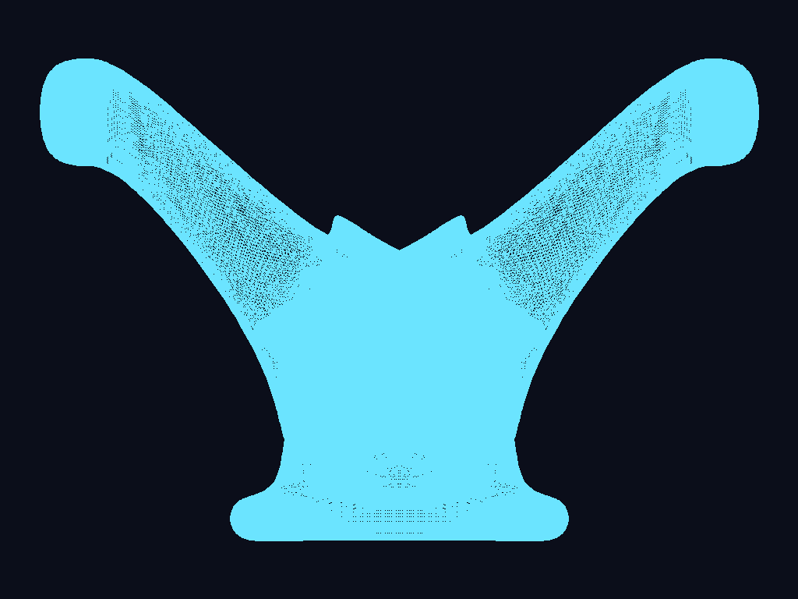
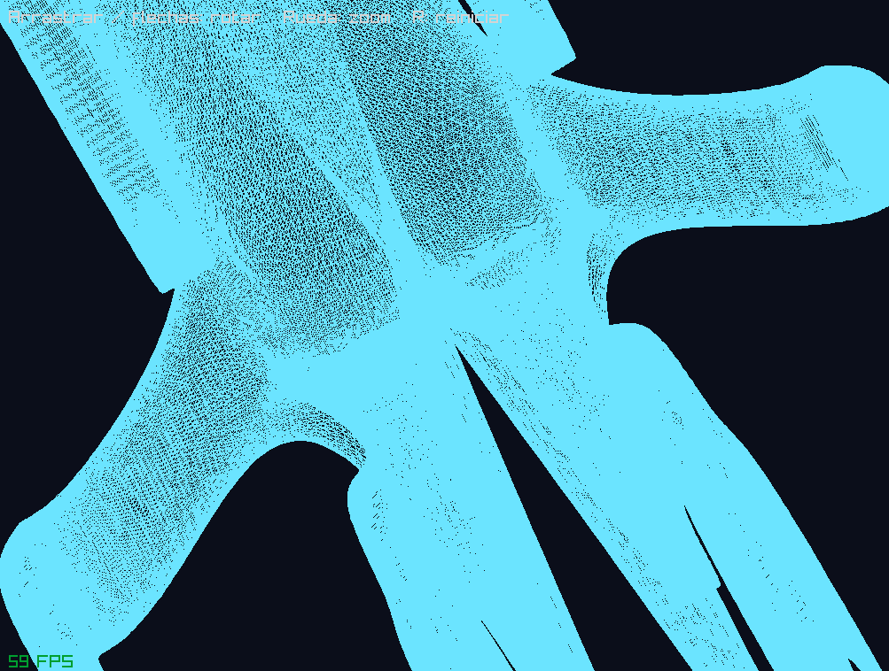
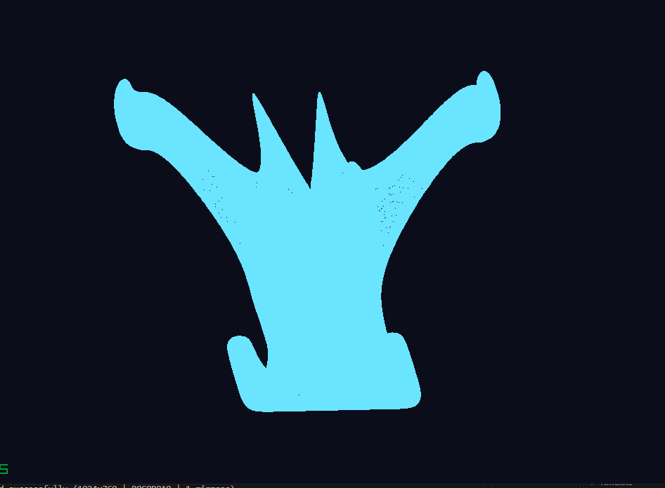
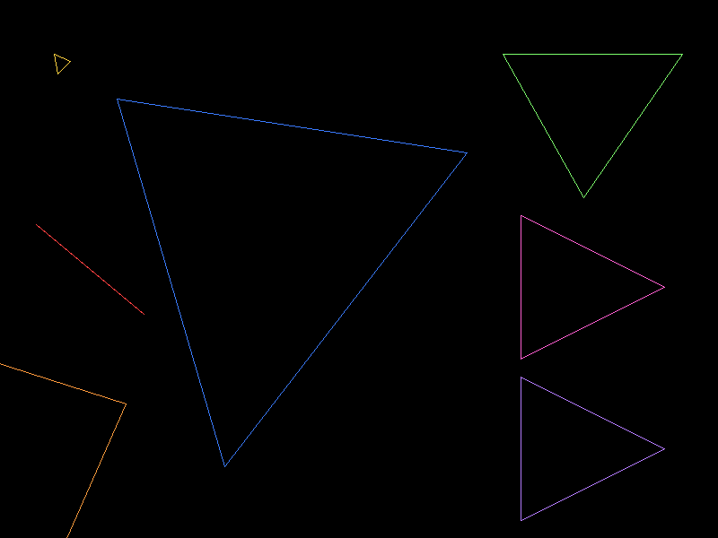
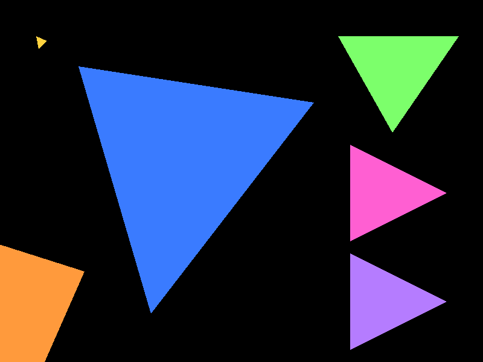
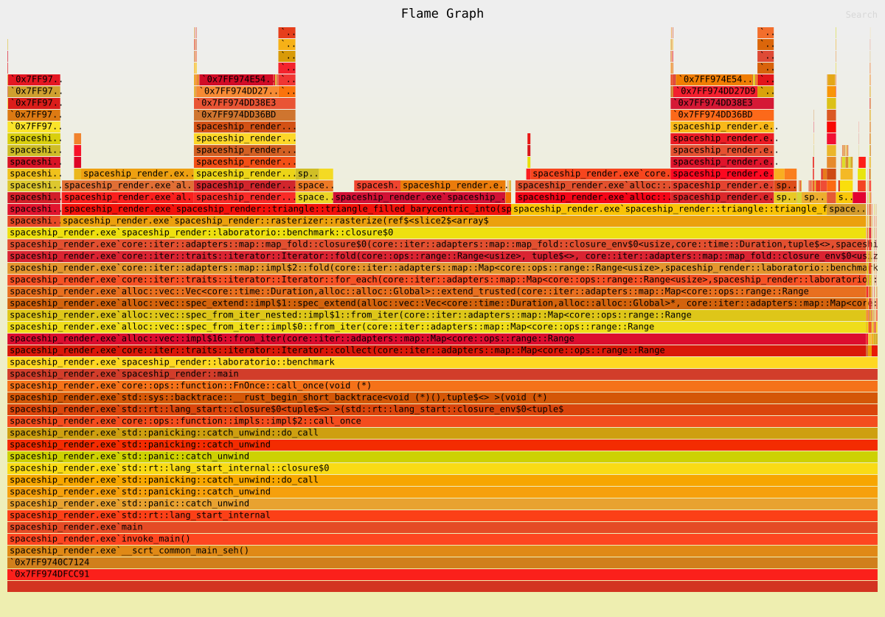

# Spaceship Render

Renderer por software escrito en Rust para el curso de Gráficas por Computadora (UVG).
Carga un modelo `.obj` hecho en Blender y dibuja sus triángulos, en contorno o
rellenos, con algoritmos propios. Raylib solo se usa para abrir la ventana, mostrar el
framebuffer como textura y guardar la captura en PNG; **no** se usan sus funciones
para cargar ni dibujar modelos.

## Laboratorio: planetas y estrellas con shaders

Tres cuerpos celestes dibujados con **la misma esfera** (`assets/sphere.obj`, la
proporcionada en clase, sin modificar sus vértices). Todo el detalle sale de los
fragment shaders en CPU de [`src/cuerpos.rs`](src/cuerpos.rs); no se usan imágenes ni
texturas. El ruido es OpenSimplex2 (fBm), deformación del dominio y ruido celular de
`fastnoise-lite`.

| Ascua (estrella) | Thalassa (planeta rocoso) | Lirio (gigante gaseoso) |
|---|---|---|
|  |  |  |

### Cómo ejecutarlo

```sh
cargo run --release
```

Abre la ventana del laboratorio (800×800). Arranca con la estrella.

| Tecla | Acción |
|---|---|
| `1` / `2` / `3` | Estrella / planeta rocoso / gigante gaseoso |
| Arrastrar con clic izquierdo / flechas | Girar la cámara alrededor de la esfera |
| `A` / `D` | Mover la luz alrededor del planeta |
| `W` / `S` | Subir / bajar la cobertura de nubes (planeta rocoso) |
| `Espacio` | Pausar el tiempo |

Cada tecla activa una función de `src/cuerpos.rs`: `estrella`, `planeta_rocoso` y
`gigante_gaseoso` (la selección está en `Cuerpo::shader`, `src/planetas.rs`).

Otros modos, sin ventana:

```sh
cargo run --release -- --capturas-planetas  # docs/planetas/{estrella,rocoso,gaseoso}.png
cargo run --release -- --evidencias         # docs/planetas/rocoso_noche.png, rocoso_nubes_*.png
cargo run --release -- --grabar             # cuadros de los GIF en target/cuadros/<clip>/
```

Los GIF se arman con ffmpeg a partir de los cuadros, por ejemplo:

```sh
ffmpeg -framerate 24 -i target/cuadros/gaseoso/%03d.png \
  -vf "split[a][b];[a]palettegen[p];[b][p]paletteuse" docs/planetas/gaseoso.gif
```

Todos los parámetros que se mencionan abajo son constantes al inicio de la sección de
cada cuerpo en `src/cuerpos.rs`; basta con cambiarlas y volver a ejecutar.

### Ascua — estrella

Una estrella naranja con la superficie en ebullición: celdas de convección, grupos de
manchas oscuras y el borde más rojo y oscuro que el centro. Es **emisiva**: no usa la luz
de la escena.


**Patrones y cómo se combinan** (`estrella`):

1. **Plasma:** fBm OpenSimplex sobre coordenadas torcidas con *domain warp*. Da manchas
   grandes calientes y frías con forma de remolino.
2. **Granulación:** ruido celular (F2 − F1), que vale −1 en el borde de cada celda. El
   borde de las celdas se enfría un poco, así se dibuja la red de "granos".
3. **Manchas:** dos ruidos multiplicados. Uno de baja frecuencia marca regiones activas
   y uno más fino da la forma. Solo hay mancha donde coinciden, así que salen pocas y
   agrupadas, con centro oscuro (umbra) y halo (penumbra).
4. **Oscurecimiento del borde:** `mu = normal · vista`; donde `mu` es pequeño (el
   borde), la temperatura baja.

Los cuatro se suman en una sola **temperatura** (0 = fría, 1 = caliente) que se pinta con
una rampa negro → rojo → naranja → amarillo → blanco. La animación mueve el punto donde
se muestrea el ruido 3D: la esfera atraviesa un campo que se desplaza, así que los
patrones cambian de forma en lugar de deslizarse en bloque.

| Parámetro | Efecto visual |
|---|---|
| `ESTRELLA_ESCALA_PLASMA` (2.4) | Mayor = remolinos de plasma más pequeños. |
| `ESTRELLA_TURBULENCIA` (1.2) | Cuánto se tuercen los remolinos; 0 = plasma "liso". |
| `ESTRELLA_ESCALA_GRANOS` (16) | Mayor = celdas de convección más pequeñas. |
| `ESTRELLA_VELOCIDAD` (0.12) | Qué tan rápido hierve la superficie. |
| `ESTRELLA_UMBRAL_REGIONES` (0.17) | Mayor = menos grupos de manchas. |
| `ESTRELLA_UMBRAL_MANCHAS` (0.12) | Mayor = manchas más pequeñas dentro de cada grupo. |

### Thalassa — planeta rocoso

Un mundo oceánico con archipiélagos, bosques, desiertos, montañas nevadas y casquetes
polares, cubierto por nubes que se mueven y proyectan sombra. De noche se ven las luces
de las ciudades.

| Luz dando la vuelta | Nubes moviéndose | Lado nocturno |
|---|---|---|
|  |  |  |

**Patrones y cómo se combinan** (`planeta_rocoso`, `superficie_thalassa`):

1. **Continentes:** fBm sobre coordenadas con *domain warp* (costas irregulares). Un
   umbral (`ROCOSO_NIVEL_MAR`) separa océano de tierra. En el océano, la distancia al
   umbral es la profundidad (turquesa en la costa, azul marino en lo profundo).
2. **Biomas:** en tierra, la elevación (cuánto supera el umbral) decide playa → tierra →
   roca → nieve; un segundo ruido de **humedad** decide bosque o desierto.
3. **Hielo:** `|y|` (latitud) más un poco de ruido para que el borde del casquete sea
   irregular.
4. **Relieve:** campo de altura de montañas que inclina las normales (bump mapping).
5. **Nubes:** máscara de fBm con *warp*, estirada a lo largo de los paralelos, encima de
   todo. Sus sombras se calculan siguiendo el rayo hacia la luz.
6. **Luces nocturnas:** dos ruidos (zonas y puntos) solo en tierra habitable y solo
   donde `normal · luz < 0`.

Orden de composición: superficie → luz difusa × (1 − sombra de nubes) → especular del
océano → luces de ciudades → nubes → borde de atmósfera azul.

| Parámetro | Efecto visual |
|---|---|
| `ROCOSO_ESCALA_CONTINENTES` (1.5) | Mayor = continentes más pequeños y numerosos. |
| `ROCOSO_NIVEL_MAR` (0.06) | Mayor = más océano y menos tierra. |
| `ROCOSO_LATITUD_HIELO` (0.8) | Menor = casquetes polares más grandes. |
| `ROCOSO_FUERZA_RELIEVE` (0.45) | Cuánto se notan las montañas; 0 = tierra lisa. |
| `ROCOSO_EXPONENTE_OCEANO` (70) | Mayor = reflejo del sol más pequeño y concentrado. |
| `NUBES_ESCALA` (2.3), `NUBES_VELOCIDAD` (0.05) | Tamaño de las nubes y qué tan rápido avanzan. |
| `NUBES_ALTURA` (0.06) | Mayor = sombras más separadas de su nube. |
| `ROCOSO_DENSIDAD_CIUDADES` (0.55) | Mayor = más luces en el lado nocturno. |
| Cobertura de nubes (`W`/`S`, `uniforms.cloud_coverage`) | De cielo despejado a casi todo nublado. |

### Lirio — gigante gaseoso

Un gigante de bandas lavanda, crema y verde azulado que fluyen como líquido, con una gran
tormenta coral que las enrosca en espiral.


**Patrones y cómo se combinan** (`gigante_gaseoso`, `atmosfera_lirio`):

1. **Bandas:** dos senos de la latitud (`sin(9·y)` y uno 2.3 veces más fino) sumados, lo
   que da bandas de anchos distintos.
2. **Fronteras líquidas:** antes de calcular los senos, la latitud se desplaza con fBm
   sobre coordenadas torcidas (*domain warp*) y con **filamentos** (ruido muy estirado
   en horizontal). Por eso las bandas ondulan y se mezclan en lugar de tener bordes
   rectos.
3. **Rotación diferencial:** cada latitud gira alrededor del eje y a otra velocidad, así
   las bandas se deslizan unas sobre otras con el tiempo.
4. **Vórtice:** antes de todo lo anterior, los puntos cerca del centro de la tormenta se
   rotan alrededor de ese centro, más cuanto más cerca están. Las bandas que pasan por ahí
   se curvan en espiral.
5. **Flujo en dos fases:** como la rotación acumula deformación, el patrón se calcula con
   dos relojes que se reinician cada 20 s, desfasados medio periodo, y se mezclan. El
   movimiento se ve continuo pero las bandas no terminan convertidas en rayas finas.

El valor de las bandas se pinta con una rampa morado → lavanda → crema → verde azulado. La
iluminación es difusa "envuelta" (terminador suave, como una atmósfera que dispersa la
luz) con un halo lavanda en el borde.

| Parámetro | Efecto visual |
|---|---|
| `GASEOSO_FRECUENCIA_BANDAS` (9) | Mayor = bandas más delgadas y numerosas. |
| `GASEOSO_LIQUIDEZ` (0.13) | Cuánto ondulan las fronteras; 0 = bandas rectas. |
| `GASEOSO_CORTE` (0.06) | Velocidad de la rotación diferencial; 0 = las bandas no se deslizan. |
| `GASEOSO_CENTRO_TORMENTA`, `GASEOSO_RADIO_TORMENTA` (0.42) | Dónde está la tormenta y qué tan grande es. |
| `GASEOSO_FUERZA_TORMENTA` (5) | Cuántas vueltas da la espiral en el centro. |
| `GASEOSO_PERIODO_FLUJO` (20) | Mayor = las bandas se estiran más antes de renovarse. |

### Efectos por los que solicitamos puntos

| Efecto | Puntos | Cuerpo | Archivo y función | Evidencia |
|---|---:|---|---|---|
| Material animado | 5 | Ascua | `src/cuerpos.rs` → `estrella` | [estrella.gif](docs/planetas/estrella.gif) |
| Tormenta o vórtice localizado | 10 | Lirio | `src/cuerpos.rs` → `vortice`, `atmosfera_lirio` | [gaseoso.gif](docs/planetas/gaseoso.gif) |
| Nubes procedurales | 10 | Thalassa | `src/cuerpos.rs` → `nubes` | [rocoso_nubes.gif](docs/planetas/rocoso_nubes.gif), [0 %](docs/planetas/rocoso_nubes_0.png) vs [80 %](docs/planetas/rocoso_nubes_80.png) |
| Sombras de nubes | 20 | Thalassa | `src/cuerpos.rs` → `sombra_nubes` | [rocoso_luz.gif](docs/planetas/rocoso_luz.gif) |
| Relieve procedural (bump mapping) | 15 | Thalassa | `src/cuerpos.rs` → `relieve`, `altura_montanas` | [rocoso_luz.gif](docs/planetas/rocoso_luz.gif) |
| Respuestas diferentes a la iluminación | 10 | Thalassa | `src/cuerpos.rs` → `planeta_rocoso` (bloque especular) | [rocoso_luz.gif](docs/planetas/rocoso_luz.gif) |
| Apariencia de día y noche | 5 | Thalassa | `src/cuerpos.rs` → `ciudades`, `planeta_rocoso` | [rocoso_noche.png](docs/planetas/rocoso_noche.png), [rocoso_luz.gif](docs/planetas/rocoso_luz.gif) |

Con los 60 puntos básicos suman más de 100; no implementamos parallax.

**Material animado (estrella).** La esfera no se mueve: lo que cambia es el punto
`p · escala + deriva(t)` donde se muestrean el plasma, las celdas y la forma de las
manchas, así que la superficie "hierve". Las nubes y el gigante gaseoso también se animan,
pero el punto se pide solo por la estrella. *Parámetro:* `ESTRELLA_VELOCIDAD`; con 0 la
estrella queda congelada, con 0.5 hierve visiblemente rápido.

**Tormenta o vórtice.** `vortice` rota cada punto dentro de `GASEOSO_RADIO_TORMENTA`
alrededor del centro de la tormenta un ángulo proporcional a `cercania²`. Ese punto ya
rotado es el que se usa para calcular las bandas, así que las bandas **alrededor** de la
tormenta se curvan y se enroscan (no es un círculo pintado encima). El ángulo crece con el
tiempo, así que la espiral gira. *Parámetro:* `GASEOSO_FUERZA_TORMENTA`; con 1 las bandas
apenas se curvan alrededor del ojo, con 10 la espiral da el doble de vueltas.

**Nubes procedurales.** `nubes` evalúa fBm con *domain warp* en `p` rotado alrededor del
eje y por `t · NUBES_VELOCIDAD`; el terreno usa `p` sin rotar, así que las nubes avanzan
sobre los continentes. Un umbral `0.5 − 1.1 · cobertura` decide qué valores del ruido son
nube, y la máscara se mezcla sobre la superficie (no hay otra esfera). *Parámetros:* la
cobertura con `W`/`S` en la ventana (comparar `rocoso_nubes_0.png` y `rocoso_nubes_80.png`)
y `NUBES_VELOCIDAD`.

**Sombras de nubes.** Para cada punto `p` de la superficie, `sombra_nubes` sigue el rayo
hacia la luz hasta la altura de la capa de nubes (`NUBES_ALTURA / cos θ`) y consulta la
máscara de nubes **en ese punto**. Si hay nube, la luz directa se reduce. Por eso la
sombra tiene la misma forma que su nube, se mueve con ella, y cuando la luz llega de lado
cae más lejos y en dirección opuesta a la luz: en `rocoso_luz.gif` se ve cómo las sombras
se desplazan alrededor de cada nube al girar la luz. *Parámetros:* `NUBES_ALTURA` (con
0.15 la sombra se separa claramente de la nube) y `NUBES_FUERZA_SOMBRA` (0 = sin sombra).

**Relieve procedural (bump mapping).** `relieve` estima el gradiente del campo de altura
`altura_montanas` con diferencias finitas, se queda con la parte tangente a la esfera y
la resta de la normal. La iluminación difusa usa esa normal inclinada, así que las
montañas tienen una ladera iluminada y otra en sombra que cambia al mover la luz con
`A`/`D` (en el GIF, el relieve "gira" con la luz aunque los vértices no cambian).
*Parámetro:* `ROCOSO_FUERZA_RELIEVE`; con 0 la tierra se ve plana, con 1 las montañas se
marcan mucho más.

**Respuestas diferentes a la iluminación.** El océano recibe un reflejo especular
Blinn-Phong (`normal · medio` elevado a `ROCOSO_EXPONENTE_OCEANO`), la tierra es solo
difusa (mate) con relieve, las nubes usan la normal lisa sin relieve, y el gigante gaseoso
usa una difusa "envuelta". En el GIF el brillo del sol recorre el océano y se apaga al
pasar sobre los continentes. *Parámetro:* `ROCOSO_EXPONENTE_OCEANO`; con 10 el reflejo es
una mancha ancha, con 200 un punto pequeño. `ROCOSO_BRILLO_OCEANO` controla su intensidad.

**Apariencia de día y noche.** `dia = normal · luz`. Donde `dia` cae por debajo de 0, una
máscara suave (`noche`) enciende las luces de `ciudades`, que solo existen en tierra
habitable (ni océano, ni hielo, ni desierto, ni montaña) y se tapan con las nubes. Del lado
iluminado no se ven. *Parámetro:* `ROCOSO_DENSIDAD_CIUDADES`; con 0.2 quedan unas pocas
ciudades aisladas, con 0.9 la tierra nocturna se llena de luces.

> **Nota sobre la esfera:** el modelo tiene pocas caras y normales planas, así que los
> shaders usan `normalize(posición)` como normal (la de una esfera perfecta). La silueta
> poligonal es la del modelo proporcionado; no se modificó.

## Proyecto 1 — Parte 1: dibujando un modelo OBJ



| | |
|---|---|
|  |  |

Modelo: `spaceship.obj`, 286,689 vértices y 573,439 triángulos.

Como todavía no hay proyección, se dibujan directamente las componentes `x` y `y`
de cada vértice (vista de frente). Los vértices se escalan con la misma escala en
ambos ejes y se trasladan para que el modelo quede centrado y ocupe el 90 % de la
ventana sin salirse.

## Cómo ejecutarlo

Requisitos: Rust (toolchain MSVC en Windows) y CMake, que el crate `raylib` usa para compilar Raylib.

Para abrir el visor de la nave:

```sh
cargo run --release -- --nave
```

Abre una ventana de 1024×768 con el modelo. Usa `--release`: en modo debug dibujar
573k triángulos es mucho más lento.

### Controles

| Entrada | Acción |
|---|---|
| Arrastrar con clic izquierdo / flechas | Rotar el modelo |
| Rueda del mouse | Zoom |
| `R` | Regresar a la vista inicial |
| `1` / `2` / `3` | Modo: wireframe / relleno baricéntrico / relleno scanline |

La ventana arranca con el zoom necesario para que el modelo quepa completo desde
cualquier ángulo. Solo se vuelve a dibujar cuando la cámara se mueve.

Para guardar la vista de frente en `captura.png` sin abrir la ventana:

```sh
cargo run --release -- --nave --captura
```

Con `--relleno` (`cargo run --release -- --relleno`) se abre la escena de prueba del
laboratorio de relleno; las teclas `1`, `2` y `3` cambian el modo. Sin argumentos se abre
el laboratorio de planetas. Otros modos del programa:

```sh
cargo run --release -- --capturas-relleno    # guarda docs/relleno_*.png
cargo run --release -- --benchmark-triangles # mide la rasterización de cada modo
```

Para correr los tests:

```sh
cargo test
```

> **Windows:** `.cargo/config.toml` le indica a `bindgen` dónde están los headers de
> MSVC porque en la máquina de desarrollo no los encontraba solo. Si tu instalación de
> Visual Studio está en otra ruta, ajústala ahí (o borra el archivo si compila sin él).

## Cómo funciona

```
spaceship.obj → Obj → arreglo de vértices → matriz de modelo (Uniforms) → triángulos → fragmentos → framebuffer → ventana
```

| Archivo | Qué hace |
|---|---|
| `src/obj.rs` | Cargador de OBJ: lee las líneas `v` (posiciones) y `f` (caras), convierte los índices de base 1 a base 0 y acepta grupos como `5/7/2`. `get_vertex_array()` devuelve los vértices ordenados por caras. |
| `src/vertex.rs` | `Vertex` con su `position` original, `color` y `transformed_position` en coordenadas de pantalla. |
| `src/render.rs` | Matriz de modelo (`create_model_matrix`), cámara orbital, encuadre y la transformación que llena `transformed_position`. |
| `src/triangle.rs` | `triangle` (contorno), `triangle_filled_barycentric` y `triangle_filled_scanline` devuelven los fragmentos de un triángulo. |
| `src/rasterizer.rs` | `TriangleMode` y `rasterize`, que genera los fragmentos de todos los triángulos en el modo elegido. |
| `src/primitive.rs` | Ensamblaje de primitivas: agrupa los vértices de tres en tres. |
| `src/shaders.rs` | `vertex_shader` (aplica la matriz de modelo) y `fragment_shader` (passthrough). |
| `src/laboratorio.rs` | Escena de prueba, capturas y mediciones del laboratorio de relleno. |
| `src/line.rs` | `line` (algoritmo de Bresenham) devuelve los fragmentos de una línea. |
| `src/fragment.rs` | `Fragment`: candidato a píxel con posición, color y profundidad. |
| `src/framebuffer.rs` | Buffer de color y z-buffer propios; `init_texture` / `swap_buffers` lo muestran en la ventana. |
| `src/color.rs` | Color RGB de 8 bits por canal. |
| `src/main.rs` | `Uniforms`, la función `render` (pipeline de 4 etapas) y la escena de prueba. |
| `src/visor.rs` | Visor de la nave: carga el modelo y maneja la cámara y la entrada. |
| `src/vertices.rs` | Ejercicio de la fase de vértices (`Vector2` y `Vector3`). |

## Laboratorio: rellenar triángulos

`rasterize` recibe un `TriangleMode`:

```rust
pub enum TriangleMode { Wireframe, FilledBarycentric, FilledScanline }
```

El ensamblaje de primitivas y el procesamiento de fragmentos no cambian; solo cambia
cómo cada triángulo se convierte en fragmentos.

### Imágenes de cada modo

Escena de prueba: triángulo pequeño (amarillo), grande (azul), con borde horizontal
(verde), con borde vertical (rosa), el mismo con sus vértices en orden inverso (morado,
180 px más abajo), parcialmente fuera del framebuffer (naranja) y tres vértices sobre una
misma línea (rojo).

| Wireframe | FilledBarycentric | FilledScanline |
|---|---|---|
|  |  |  |

El triángulo rojo (vértices colineales) solo aparece en wireframe: su área es cero, así
que los rellenos lo tratan como degenerado, no generan fragmentos y no dividen entre
cero. El morado tiene exactamente las mismas posiciones que el rosa.

### Los dos algoritmos

- **Baricéntrico:** recorre el rectángulo que envuelve al triángulo y, para el centro de
  cada píxel `(x + 0.5, y + 0.5)`, calcula sus tres coordenadas baricéntricas (con
  *edge functions*). Si las tres indican que el centro está adentro, genera un fragmento.
- **Scanline:** para cada fila calcula dónde la cruzan las aristas y genera los fragmentos
  entre esos dos extremos, sin evaluar los píxeles del interior.

**Una sola regla para los bordes.** Los dos usan la misma prueba para decidir si un centro
está dentro, con la regla *top-left* para los centros que caen justo sobre una arista: se
dibujan solo si la arista es superior o izquierda. Así, dos triángulos que comparten una
arista no dejan huecos ni generan el mismo píxel dos veces; un test con un cuadrado
dividido por su diagonal da exactamente 100 píxeles sin repetir.

El scanline calcula los extremos de cada fila con una división, que puede tener errores
de redondeo, y después ajusta solo esos extremos con la misma prueba del baricéntrico.
Por eso los dos algoritmos generan **exactamente las mismas posiciones**. Los tests lo
comprueban con cada caso de la escena y con 500 triángulos aleatorios, y la medición lo
comprueba con la nave completa. Las imágenes de los dos rellenos son idénticas píxel por
píxel.

Si los vértices vienen en el orden contrario, se intercambian dos para que el área sea
positiva; el triángulo no desaparece.

### Mediciones

`cargo run --release -- --benchmark-triangles`. Solo se mide `rasterize` (generar y
guardar los fragmentos): los triángulos se preparan antes y no se dibuja ninguna ventana.
Cada medición ejecuta `rasterize` varias veces con `black_box`; se reporta la mediana de 7
mediciones. La salida completa está en [`docs/benchmark.txt`](docs/benchmark.txt).

| Caso | Modo | Tiempo por ejecución | Fragmentos | ns por fragmento |
|---|---|---:|---:|---:|
| Escena de prueba (7 triángulos) | Wireframe | 0.010 ms | 3,735 | 2.72 |
| Escena de prueba (7 triángulos) | FilledBarycentric | 1.98 ms | 149,465 | 13.23 |
| Escena de prueba (7 triángulos) | FilledScanline | 1.37 ms | 149,465 | 9.16 |
| Triángulos grandes (500) | Wireframe | 1.39 ms | 124,242 | 11.22 |
| Triángulos grandes (500) | FilledBarycentric | 28.98 ms | 1,348,422 | 21.49 |
| Triángulos grandes (500) | FilledScanline | 18.66 ms | 1,348,422 | 13.84 |
| Nave (573,439 triángulos) | Wireframe | 115.05 ms | 4,441,533 | 25.90 |
| Nave (573,439 triángulos) | FilledBarycentric | 36.63 ms | 495,722 | 73.90 |
| Nave (573,439 triángulos) | FilledScanline | 56.99 ms | 495,722 | 114.97 |

Los dos rellenos generan la misma cantidad de fragmentos en cada caso, así que la
comparación es justa: ninguno es más rápido por omitir parte del triángulo.

### Diferencias que encontramos

1. **Con triángulos grandes gana el scanline (~1.5× más rápido).** El baricéntrico evalúa
   tres *edge functions* en cada píxel del rectángulo que envuelve al triángulo, y cerca
   de la mitad de ese rectángulo queda fuera del triángulo: trabajo desperdiciado. El
   scanline solo calcula los dos extremos de cada fila y luego agrega fragmentos sin
   evaluar nada.
2. **Con la nave gana el baricéntrico (~1.6× más rápido).** Sus triángulos son diminutos:
   en promedio generan **menos de un fragmento** (495,722 fragmentos para 573,439
   triángulos). Ahí pesa el trabajo fijo por triángulo, no el trabajo por píxel. El
   rectángulo del baricéntrico casi siempre tiene 0 o 1 píxeles, mientras que el scanline
   calcula cruces con las tres aristas y ajusta los extremos de cada fila.
3. **Para la nave, rellenar es ~3× más rápido que el wireframe.** Cada línea genera al
   menos un fragmento por extremo, así que un triángulo diminuto produce varios
   fragmentos en contorno (4.4M en total) y casi ninguno relleno.
4. **Guardar los fragmentos cuesta tanto como calcularlos.** Para investigarlo, repetimos
   la medición de los triángulos grandes reutilizando el mismo `Vec` en lugar de crear uno
   nuevo en cada ejecución: el scanline bajó de ~20 ms a ~5 ms y el baricéntrico de
   ~31 ms a ~15 ms. Con triángulos grandes, ~75 % del tiempo del scanline se va en pedir
   memoria nueva al sistema y llenarla (un `Vec` de ~32 MB por ejecución), no en el
   algoritmo. Sin ese costo, el scanline es ~3× más rápido que el baricéntrico.

### Perfil

```sh
cargo install flamegraph
cargo flamegraph -- --benchmark-triangles   # en una terminal de administrador
```

En Windows, `cargo flamegraph` necesita permisos de administrador para leer los eventos
de rendimiento del sistema. `Cargo.toml` activa `debug = true` en el perfil release para
que el perfil muestre los nombres de las funciones; no cambia la optimización.

[](docs/flamegraph.svg)

Abre [`docs/flamegraph.svg`](docs/flamegraph.svg) en el navegador para hacer zoom y
buscar funciones. El ancho de cada bloque es la proporción de muestras en las que apareció
esa función, no el orden en que se ejecutó.

`rasterize` aparece en el 93 % de las muestras; el resto es preparar los triángulos de la
nave y comparar las posiciones. Dentro de cada relleno, el tiempo se reparte así:

| Dentro de… | Prueba "¿está adentro?" (`dentro`, `edge`, `pasa`) | Escribir el fragmento (`Vec::push`) | Hacer crecer el `Vec` (`reserve` → `grow_amortized` → sistema) | Cruces de aristas (`tramo`) |
|---|---:|---:|---:|---:|
| `triangle_filled_barycentric_into` (52 % del total) | 38 % | 29 % | 23 % | — |
| `triangle_filled_scanline_into` (37 % del total) | 2 % | 49 % | 33 % | 8 % |

- **Baricéntrico:** el cálculo geométrico es su parte más grande (38 %): las tres *edge
  functions* que evalúa en cada píxel del rectángulo, incluidos los que quedan fuera.
- **Scanline:** casi no hace cálculos geométricos (10 % entre `tramo` y `dentro`); el
  **82 % de su tiempo es memoria**: escribir los fragmentos y hacer crecer el `Vec`.
- Los bloques sin nombre (`0x7FF9…`) son funciones de Windows (`ntdll`) que aparecen al
  copiar el `Vec` a un bloque más grande y al liberarlo.

Esto confirma el experimento de la sección anterior: en este renderer, crear y guardar
fragmentos cuesta más que decidir qué píxeles cubre el triángulo. La mejora más grande ya
no estaría en el algoritmo de relleno, sino en no guardar todos los fragmentos en un `Vec`
(por ejemplo, reutilizar el mismo `Vec` entre cuadros o escribir cada fragmento en cuanto se
genera).

### Preguntas del laboratorio

**¿Cómo determinan qué posiciones de la imagen están dentro de un triángulo?**
Se evalúa el centro de cada píxel, `(x + 0.5, y + 0.5)`. Con las tres *edge functions* se
obtienen sus coordenadas baricéntricas sin normalizar, `w0`, `w1` y `w2`; las
baricéntricas son `w0 / área`, `w1 / área` y `w2 / área`. Si las tres son positivas, el
centro está dentro. Si alguna es cero, el centro cae justo sobre una arista y decide la
regla top-left (ver abajo).

**Si invierten el orden de los vértices, ¿desaparece el triángulo?**
No. Con el orden invertido el área sale negativa y todas las `w` cambian de signo, así que
la prueba "las tres positivas" fallaría siempre. Para evitarlo, si el área es negativa se
intercambian dos vértices antes de rellenar. En la escena, el triángulo morado es el rosa
con sus vértices en orden inverso y cubre exactamente los mismos 12,800 píxeles.

**¿Qué hacen si el área del triángulo es cero?**
Lo tratan como degenerado: `Relleno::new` devuelve `None` y no se genera ningún fragmento,
así que nunca se divide entre el área. Es el caso de los tres vértices sobre una misma línea
(el triángulo rojo): en wireframe se ve como una línea y relleno no aparece.

**¿Cómo tratan las aristas horizontales y los vértices que coinciden exactamente con una
fila?**
- **Aristas horizontales:** en el scanline, una arista horizontal no tiene un cruce con la
  fila (dividir entre su altura sería dividir entre cero). Si está justo sobre la fila, se
  toman sus dos extremos como límites del tramo; si no, se ignora.
- **Vértices sobre una fila:** cuando la fila pasa exactamente por un vértice, las dos
  aristas que llegan a él dan el mismo cruce, y el tramo se calcula una sola vez por fila,
  así que no se duplican fragmentos.
- **Centros sobre una arista:** se dibujan solo si la arista es **superior** (horizontal,
  con el triángulo debajo) o **izquierda**. Es la regla *top-left* que usan las GPUs. Sin
  una regla así, dos triángulos que comparten una arista dejan huecos (si ninguno dibuja
  esos píxeles) o fragmentos duplicados (si los dos los dibujan). El test
  `shared_edge_has_no_gaps_and_no_duplicates` divide un cuadrado de 10 × 10 por su diagonal,
  que pasa justo por centros de píxeles, y obtiene exactamente 100 fragmentos sin repetir.

**¿Producen los dos algoritmos la misma figura? Si hay diferencias en un borde, ¿qué regla
usa cada implementación?**
Producen **exactamente las mismas posiciones**, porque usan la misma regla para los bordes.
El baricéntrico aplica la prueba a cada píxel del rectángulo que envuelve al triángulo. El
scanline calcula los extremos de cada fila con una división; como esa división puede tener
errores de redondeo justo en los bordes, después ajusta **solo los extremos** con la misma
prueba del baricéntrico. Los píxeles del interior del tramo no se evalúan.

Sin ese ajuste, la división podría dejar fuera o meter de más un píxel cuyo centro cae
justo sobre una arista, y ahí los dos algoritmos diferirían. Se
comparan las posiciones, no solo la imagen: los tests lo comprueban en cada caso de la escena
y con 500 triángulos aleatorios, `--benchmark-triangles` lo comprueba con los 573,439
triángulos de la nave, y las dos imágenes rellenas son idénticas píxel por píxel.

**¿Por qué registrar cuántos fragmentos produce cada algoritmo?**
Porque una versión que omite parte del triángulo parecería más rápida solo por hacer menos
trabajo. Aquí los dos rellenos producen la misma cantidad de fragmentos en cada caso (por
ejemplo, 1,348,422 con los triángulos grandes), así que la diferencia de tiempo se debe al
algoritmo.

**En el flamegraph, ¿qué ocupa más espacio: los cálculos geométricos, la creación de
fragmentos o el crecimiento del `Vec`?**
Depende del algoritmo (ver la tabla de la sección "Perfil"):
- **Baricéntrico:** lo más grande son los **cálculos geométricos** (38 %), por evaluar tres
  *edge functions* en cada píxel del rectángulo; le siguen la creación de fragmentos (29 %)
  y el crecimiento del `Vec` (23 %).
- **Scanline:** casi no hace cálculos geométricos (10 %); lo que domina es la **creación de
  fragmentos** (49 %) y el **crecimiento del `Vec`** (33 %).

Sumando las dos, el manejo de memoria es la mayor parte del tiempo de rasterización en este
renderer.

**¿Cuál algoritmo conviene?**
Depende del tamaño de los triángulos. Con triángulos grandes, el scanline es ~1.5× más
rápido porque no evalúa los píxeles que quedan fuera del triángulo. Con triángulos diminutos,
como los de la nave (menos de un fragmento por triángulo en promedio), gana el baricéntrico
porque su trabajo fijo por triángulo es menor.
