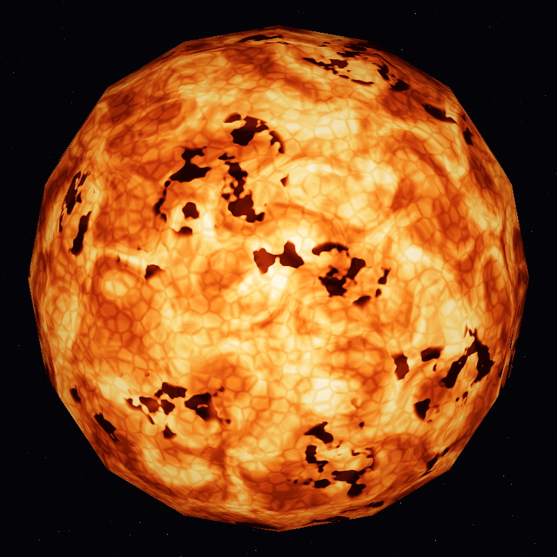
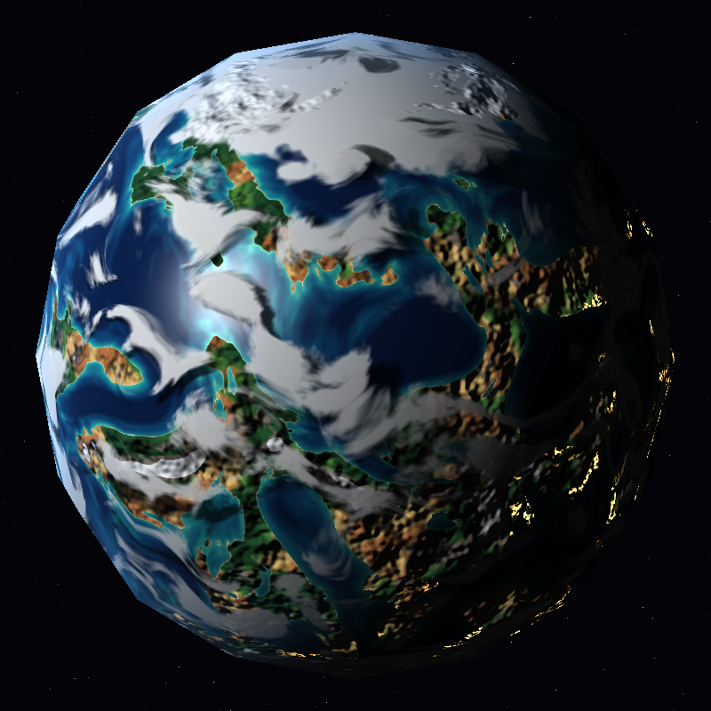
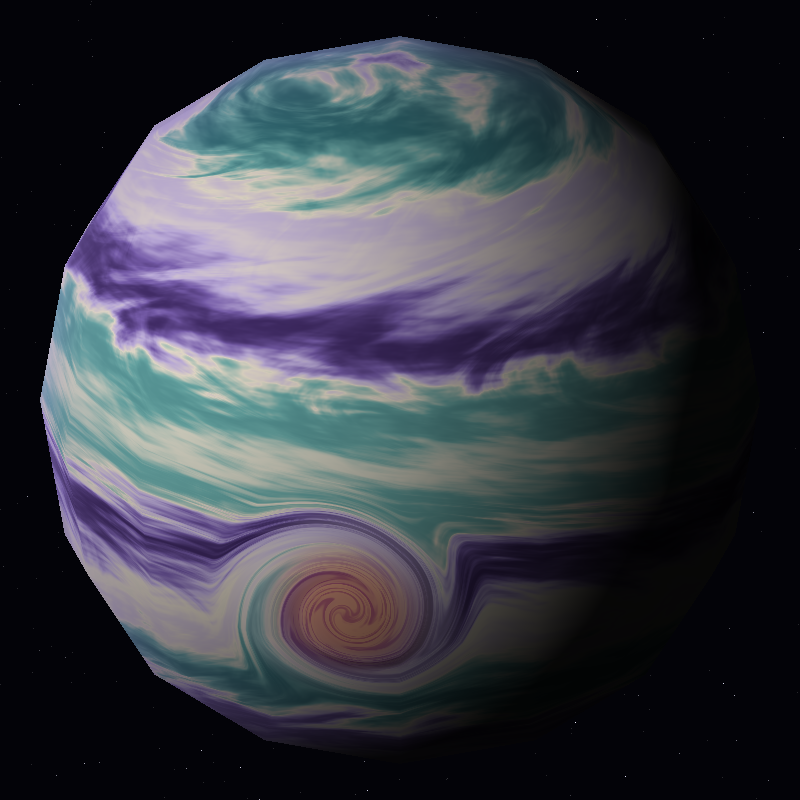
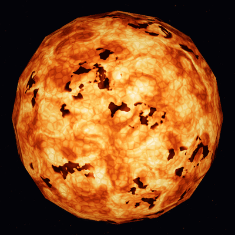
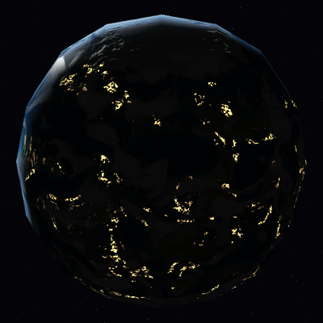
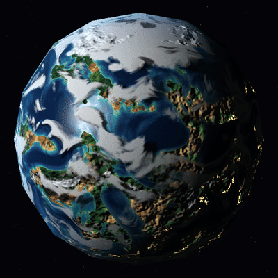
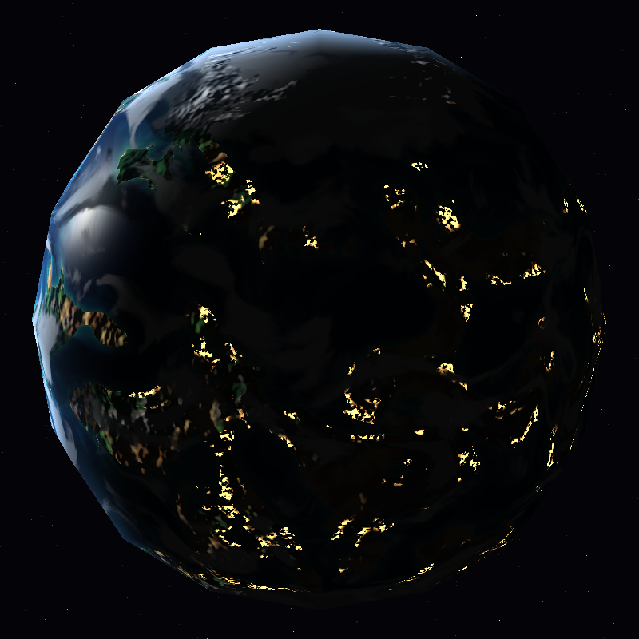
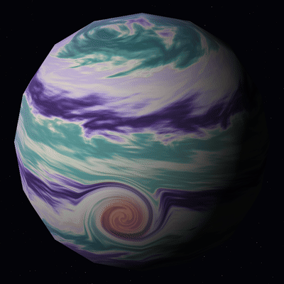

# Laboratorio: planetas y estrellas con shaders

Renderer por software en CPU escrito en Rust para el curso de Gráficas por Computadora
(UVG). Raylib solo se usa para abrir la ventana y mostrar el framebuffer como textura;
la rasterización y los shaders son propios.

Tres cuerpos celestes dibujados con **la misma esfera** (`assets/sphere.obj`, la
proporcionada en clase, sin modificar sus vértices). Todo el detalle sale de los
fragment shaders en CPU de [`src/cuerpos.rs`](src/cuerpos.rs); no se usan imágenes ni
texturas. El ruido es OpenSimplex2 (fBm), deformación del dominio y ruido celular de
`fastnoise-lite`.

| Ascua (estrella) | Thalassa (planeta rocoso) | Lirio (gigante gaseoso) |
|---|---|---|
|  |  |  |

## Cómo ejecutarlo

Requisitos (Windows):

- Rust con la toolchain MSVC ([rustup](https://rustup.rs)).
- Build Tools de Visual Studio 2022 con la carga de trabajo "Desarrollo de escritorio con C++".
- CMake y LLVM, que el crate `raylib` usa para compilar Raylib. La variable de entorno
  `LIBCLANG_PATH` debe apuntar a la carpeta `bin` de LLVM (por ejemplo
  `C:\Program Files\LLVM\bin`).

```sh
cargo run --release
```

Se recomienda `--release`: en modo debug los shaders son mucho más lentos. Se abre la
ventana del laboratorio (800×800), que arranca con la estrella.

| Tecla | Acción |
|---|---|
| `1` / `2` / `3` | Estrella / planeta rocoso / gigante gaseoso |
| Arrastrar con clic izquierdo / flechas | Girar la cámara alrededor de la esfera |
| `A` / `D` | Mover la luz alrededor del planeta |
| `W` / `S` | Subir / bajar la cobertura de nubes (planeta rocoso) |
| `Espacio` | Pausar el tiempo |

Cada tecla activa una función de `src/cuerpos.rs`: `estrella`, `planeta_rocoso` y
`gigante_gaseoso` (la selección está en `Cuerpo::shader`, `src/planetas.rs`).

Otros modos, sin ventana:

```sh
cargo run --release -- --capturas-planetas  # docs/planetas/{estrella,rocoso,gaseoso}.png
cargo run --release -- --evidencias         # docs/planetas/rocoso_noche.png, rocoso_nubes_*.png
cargo run --release -- --grabar             # cuadros de los GIF en target/cuadros/<clip>/
cargo test                                  # pruebas
```

Los GIF se arman con ffmpeg a partir de los cuadros, por ejemplo:

```sh
ffmpeg -framerate 24 -i target/cuadros/gaseoso/%03d.png \
  -vf "split[a][b];[a]palettegen[p];[b][p]paletteuse" docs/planetas/gaseoso.gif
```

Todos los parámetros que se mencionan abajo son constantes al inicio de la sección de
cada cuerpo en `src/cuerpos.rs`; al cambiarlas y volver a ejecutar se ve el efecto.

## Ascua — estrella

Una estrella naranja con la superficie en ebullición: celdas de convección, grupos de
manchas oscuras y el borde más rojo y oscuro que el centro. Es **emisiva**: no usa la luz
de la escena.



**Patrones y cómo se combinan** (`estrella`):

1. **Plasma:** fBm OpenSimplex sobre coordenadas torcidas con *domain warp*. Da manchas
   grandes calientes y frías con forma de remolino.
2. **Granulación:** ruido celular (F2 − F1), que vale −1 en el borde de cada celda. El
   borde de las celdas se enfría un poco, así se dibuja la red de "granos".
3. **Manchas:** dos ruidos multiplicados. Uno de baja frecuencia marca regiones activas
   y uno más fino da la forma. Solo hay mancha donde coinciden, así que salen pocas y
   agrupadas, con centro oscuro (umbra) y halo (penumbra).
4. **Oscurecimiento del borde:** `mu = normal · vista`; donde `mu` es pequeño (el
   borde), la temperatura baja.

Los cuatro se suman en una sola **temperatura** (0 = fría, 1 = caliente) que se pinta con
una rampa negro → rojo → naranja → amarillo → blanco. La animación mueve el punto donde
se muestrea el ruido 3D: la esfera atraviesa un campo que se desplaza, así que los
patrones cambian de forma en lugar de deslizarse en bloque.

| Parámetro | Efecto visual |
|---|---|
| `ESTRELLA_ESCALA_PLASMA` (2.4) | Mayor = remolinos de plasma más pequeños. |
| `ESTRELLA_TURBULENCIA` (1.2) | Cuánto se tuercen los remolinos; 0 = plasma "liso". |
| `ESTRELLA_ESCALA_GRANOS` (16) | Mayor = celdas de convección más pequeñas. |
| `ESTRELLA_VELOCIDAD` (0.12) | Qué tan rápido hierve la superficie. |
| `ESTRELLA_UMBRAL_REGIONES` (0.17) | Mayor = menos grupos de manchas. |
| `ESTRELLA_UMBRAL_MANCHAS` (0.12) | Mayor = manchas más pequeñas dentro de cada grupo. |

## Thalassa — planeta rocoso

Un mundo oceánico con archipiélagos, bosques, desiertos, montañas nevadas y casquetes
polares, cubierto por nubes que se mueven y proyectan sombra. De noche se ven las luces
de las ciudades.

| Luz dando la vuelta | Nubes moviéndose | Lado nocturno |
|---|---|---|
|  |  |  |

**Patrones y cómo se combinan** (`planeta_rocoso`, `superficie_thalassa`):

1. **Continentes:** fBm sobre coordenadas con *domain warp* (costas irregulares). Un
   umbral (`ROCOSO_NIVEL_MAR`) separa océano de tierra. En el océano, la distancia al
   umbral es la profundidad (turquesa en la costa, azul marino en lo profundo).
2. **Biomas:** en tierra, la elevación (cuánto supera el umbral) decide playa → tierra →
   roca → nieve; un segundo ruido de **humedad** decide bosque o desierto.
3. **Hielo:** `|y|` (latitud) más un poco de ruido para que el borde del casquete sea
   irregular.
4. **Relieve:** campo de altura de montañas que inclina las normales (bump mapping).
5. **Nubes:** máscara de fBm con *warp*, estirada a lo largo de los paralelos, encima de
   todo. Sus sombras se calculan siguiendo el rayo hacia la luz.
6. **Luces nocturnas:** dos ruidos (zonas y puntos) solo en tierra habitable y solo
   donde `normal · luz < 0`.

Orden de composición: superficie → luz difusa × (1 − sombra de nubes) → especular del
océano → luces de ciudades → nubes → borde de atmósfera azul.

| Parámetro | Efecto visual |
|---|---|
| `ROCOSO_ESCALA_CONTINENTES` (1.5) | Mayor = continentes más pequeños y numerosos. |
| `ROCOSO_NIVEL_MAR` (0.06) | Mayor = más océano y menos tierra. |
| `ROCOSO_LATITUD_HIELO` (0.8) | Menor = casquetes polares más grandes. |
| `ROCOSO_FUERZA_RELIEVE` (0.45) | Cuánto se notan las montañas; 0 = tierra lisa. |
| `ROCOSO_EXPONENTE_OCEANO` (70) | Mayor = reflejo del sol más pequeño y concentrado. |
| `NUBES_ESCALA` (2.3), `NUBES_VELOCIDAD` (0.05) | Tamaño de las nubes y qué tan rápido avanzan. |
| `NUBES_ALTURA` (0.06) | Mayor = sombras más separadas de su nube. |
| `ROCOSO_DENSIDAD_CIUDADES` (0.55) | Mayor = más luces en el lado nocturno. |
| Cobertura de nubes (`W`/`S`, `uniforms.cloud_coverage`) | De cielo despejado a casi todo nublado. |

## Lirio — gigante gaseoso

Un gigante de bandas lavanda, crema y verde azulado que fluyen como líquido, con una gran
tormenta coral que las enrosca en espiral.



**Patrones y cómo se combinan** (`gigante_gaseoso`, `atmosfera_lirio`):

1. **Bandas:** dos senos de la latitud (`sin(9·y)` y uno 2.3 veces más fino) sumados, lo
   que da bandas de anchos distintos.
2. **Fronteras líquidas:** antes de calcular los senos, la latitud se desplaza con fBm
   sobre coordenadas torcidas (*domain warp*) y con **filamentos** (ruido muy estirado
   en horizontal). Por eso las bandas ondulan y se mezclan en lugar de tener bordes
   rectos.
3. **Rotación diferencial:** cada latitud gira alrededor del eje y a otra velocidad, así
   las bandas se deslizan unas sobre otras con el tiempo.
4. **Vórtice:** antes de todo lo anterior, los puntos cerca del centro de la tormenta se
   rotan alrededor de ese centro, más cuanto más cerca están. Las bandas que pasan por ahí
   se curvan en espiral.
5. **Flujo en dos fases:** como la rotación acumula deformación, el patrón se calcula con
   dos relojes que se reinician cada 20 s, desfasados medio periodo, y se mezclan. El
   movimiento se ve continuo pero las bandas no terminan convertidas en rayas finas.

El valor de las bandas se pinta con una rampa morado → lavanda → crema → verde azulado. La
iluminación es difusa "envuelta" (terminador suave, como una atmósfera que dispersa la
luz) con un halo lavanda en el borde.

| Parámetro | Efecto visual |
|---|---|
| `GASEOSO_FRECUENCIA_BANDAS` (9) | Mayor = bandas más delgadas y numerosas. |
| `GASEOSO_LIQUIDEZ` (0.13) | Cuánto ondulan las fronteras; 0 = bandas rectas. |
| `GASEOSO_CORTE` (0.06) | Velocidad de la rotación diferencial; 0 = las bandas no se deslizan. |
| `GASEOSO_CENTRO_TORMENTA`, `GASEOSO_RADIO_TORMENTA` (0.42) | Dónde está la tormenta y qué tan grande es. |
| `GASEOSO_FUERZA_TORMENTA` (5) | Cuántas vueltas da la espiral en el centro. |
| `GASEOSO_PERIODO_FLUJO` (20) | Mayor = las bandas se estiran más antes de renovarse. |

## Efectos de la rúbrica implementados

| Efecto | Cuerpo | Archivo y función | Evidencia |
|---|---|---|---|
| Material animado | Ascua | `src/cuerpos.rs` → `estrella` | [estrella.gif](docs/planetas/estrella.gif) |
| Tormenta o vórtice localizado | Lirio | `src/cuerpos.rs` → `vortice`, `atmosfera_lirio` | [gaseoso.gif](docs/planetas/gaseoso.gif) |
| Nubes procedurales | Thalassa | `src/cuerpos.rs` → `nubes` | [rocoso_nubes.gif](docs/planetas/rocoso_nubes.gif), [0 %](docs/planetas/rocoso_nubes_0.png) vs [80 %](docs/planetas/rocoso_nubes_80.png) |
| Sombras de nubes | Thalassa | `src/cuerpos.rs` → `sombra_nubes` | [rocoso_luz.gif](docs/planetas/rocoso_luz.gif) |
| Relieve procedural (bump mapping) | Thalassa | `src/cuerpos.rs` → `relieve`, `altura_montanas` | [rocoso_luz.gif](docs/planetas/rocoso_luz.gif) |
| Respuestas diferentes a la iluminación | Thalassa | `src/cuerpos.rs` → `planeta_rocoso` (bloque especular) | [rocoso_luz.gif](docs/planetas/rocoso_luz.gif) |
| Apariencia de día y noche | Thalassa | `src/cuerpos.rs` → `ciudades`, `planeta_rocoso` | [rocoso_noche.png](docs/planetas/rocoso_noche.png), [rocoso_luz.gif](docs/planetas/rocoso_luz.gif) |

**Material animado (estrella).** La esfera no se mueve: lo que cambia es el punto
`p · escala + deriva(t)` donde se muestrean el plasma, las celdas y la forma de las
manchas, así que la superficie "hierve". Las nubes y el gigante gaseoso también se animan,
pero este criterio se asigna a la estrella. *Parámetro:* `ESTRELLA_VELOCIDAD`; con 0 la
estrella queda congelada, con 0.5 hierve visiblemente rápido.

**Tormenta o vórtice.** `vortice` rota cada punto dentro de `GASEOSO_RADIO_TORMENTA`
alrededor del centro de la tormenta un ángulo proporcional a `cercania²`. Ese punto ya
rotado es el que se usa para calcular las bandas, así que las bandas **alrededor** de la
tormenta se curvan y se enroscan (no es un círculo pintado encima). El ángulo crece con el
tiempo, así que la espiral gira. *Parámetro:* `GASEOSO_FUERZA_TORMENTA`; con 1 las bandas
apenas se curvan alrededor del ojo, con 10 la espiral da el doble de vueltas.

**Nubes procedurales.** `nubes` evalúa fBm con *domain warp* en `p` rotado alrededor del
eje y por `t · NUBES_VELOCIDAD`; el terreno usa `p` sin rotar, así que las nubes avanzan
sobre los continentes. Un umbral `0.5 − 1.1 · cobertura` decide qué valores del ruido son
nube, y la máscara se mezcla sobre la superficie (no hay otra esfera). *Parámetros:* la
cobertura con `W`/`S` en la ventana (ver `rocoso_nubes_0.png` frente a `rocoso_nubes_80.png`)
y `NUBES_VELOCIDAD`.

**Sombras de nubes.** Para cada punto `p` de la superficie, `sombra_nubes` sigue el rayo
hacia la luz hasta la altura de la capa de nubes (`NUBES_ALTURA / cos θ`) y consulta la
máscara de nubes **en ese punto**. Si hay nube, la luz directa se reduce. Por eso la
sombra tiene la misma forma que su nube, se mueve con ella, y cuando la luz llega de lado
cae más lejos y en dirección opuesta a la luz: en `rocoso_luz.gif` se ve cómo las sombras
se desplazan alrededor de cada nube al girar la luz. *Parámetros:* `NUBES_ALTURA` (con
0.15 la sombra se separa claramente de la nube) y `NUBES_FUERZA_SOMBRA` (0 = sin sombra).

**Relieve procedural (bump mapping).** `relieve` estima el gradiente del campo de altura
`altura_montanas` con diferencias finitas, se queda con la parte tangente a la esfera y
la resta de la normal. La iluminación difusa usa esa normal inclinada, así que las
montañas tienen una ladera iluminada y otra en sombra que cambia al mover la luz con
`A`/`D` (en el GIF, el relieve "gira" con la luz aunque los vértices no cambian).
*Parámetro:* `ROCOSO_FUERZA_RELIEVE`; con 0 la tierra se ve plana, con 1 las montañas se
marcan mucho más.

**Respuestas diferentes a la iluminación.** El océano recibe un reflejo especular
Blinn-Phong (`normal · medio` elevado a `ROCOSO_EXPONENTE_OCEANO`), la tierra es solo
difusa (mate) con relieve, las nubes usan la normal lisa sin relieve, y el gigante gaseoso
usa una difusa "envuelta". En el GIF el brillo del sol recorre el océano y se apaga al
pasar sobre los continentes. *Parámetro:* `ROCOSO_EXPONENTE_OCEANO`; con 10 el reflejo es
una mancha ancha, con 200 un punto pequeño. `ROCOSO_BRILLO_OCEANO` controla su intensidad.

**Apariencia de día y noche.** `dia = normal · luz`. Donde `dia` cae por debajo de 0, una
máscara suave (`noche`) enciende las luces de `ciudades`, que solo existen en tierra
habitable (ni océano, ni hielo, ni desierto, ni montaña) y se tapan con las nubes. Del lado
iluminado no se ven. *Parámetro:* `ROCOSO_DENSIDAD_CIUDADES`; con 0.2 quedan unas pocas
ciudades aisladas, con 0.9 la tierra nocturna se llena de luces.

> **Nota sobre la esfera:** el modelo tiene pocas caras y normales planas, así que los
> shaders usan `normalize(posición)` como normal (la de una esfera perfecta). La silueta
> poligonal es la del modelo proporcionado; no se modificó.

